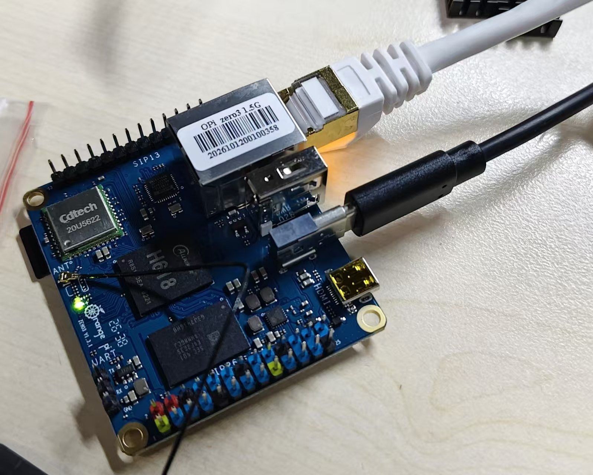

最初的想法来源于室友 Lunemere（一位科研巨佬 😏）。他用树莓派搭了一台校园小服务器，用来跑科研任务和一些日常脚本。我了解之后觉得很有意思，网购了一块更便宜的香橙派（加上 TF 卡、读卡器、外壳等，总共花了 300 多），最终成功跑通。

它可以日常运行一些 td 脚本（这个似乎是不能乱说的，记得保密 😋），也可以部署一些个人小 demo，比如我的个人代码托管平台 git.mikedsr.top；还能在实战中学点 Linux 运维知识。总之挺好玩就对了，话不多说，我们一起开启实战吧！

> **这篇会带你走完：** 烧录系统 → 用网线直连电脑 → 系统初始化 → 校园网自动重连 → 远程访问与安全加固 → 装上外壳。

## 我的配置


*到手的 Orange Pi Zero 3：插上网线和 Type-C 电源，指示灯亮起就是开机了*

| 配件 | 型号 | 说明 |
| --- | --- | --- |
| 主板 | Orange Pi Zero 3，1.5GB 内存 | 1.5G 内存有点小，好在我主要是玩玩，便宜就好 😁 |
| 电源 | 官方 5V 3A 电源 | 要长时间插电，最好买官方适配器 |
| 存储 | 联想 32GB TF 卡 | 据说联想的 TF 卡在这种小主机上容易出故障，长期用可以考虑闪迪 |
| 读卡器 | 川宇读卡器 | 无所谓，随便买一个就好 |
| 网线 | CAT6A 网线 | 宿舍有网口，我买了一米长的，按使用场景选 |

## 1. 下载并烧录系统

香橙派买回来是一块「裸」的硬件，里面没有系统，就像买了一台新电脑，但硬盘是空的。为了让它能开机、能上网、能运行软件，我们得先给它装一个系统。

由于性能较弱、内存有限，我选择了**不带桌面的 Server 版**：好处是流畅一点，坏处是没有图形界面，对不习惯命令行操作的新手可能略有挑战。

1. 在官网下载 **The image of the linux6.1 kernel version.zip** 并解压：[国内官网](http://www.orangepi.cn/html/hardWare/computerAndMicrocontrollers/service-and-support/Orange-Pi-Zero-3.html) ｜ [海外官网](http://www.orangepi.org/html/hardWare/computerAndMicrocontrollers/service-and-support/Orange-Pi-Zero-3.html)
2. 把 TF 卡插进读卡器，读卡器插到电脑的 USB 口。
3. 用 [Rufus](https://rufus.ie/zh/) 烧录：下载 Rufus 4.x 便携版，选好对应的盘和镜像文件后确认，系统就写进这张 TF 卡了。

> **踩坑：** 我最初用的是 balenaEtcher，结果发现它和我的读卡器（DD-TEK）不兼容，换成 Rufus 才成功。如果 Etcher 一直报错，不妨也换 Rufus 试试。

## 2. 用网线直连电脑


*示意图：电脑当网关，香橙派在网线另一头*

宿舍没有路由器，所以我先用网线把香橙派直连电脑，让电脑把自己连着的 Wi-Fi 网络分享给它。

1. 把烧录好的 TF 卡插进香橙派卡槽，网线一头插香橙派的网口，另一头插电脑的以太网口。
2. 打开电脑的网络共享：按 `Win + R` 弹出运行窗口，输入 `ncpa.cpl` 回车，打开「网络连接」窗口。
3. 右键 **WLAN** → 属性 → 「共享」，勾选「允许其他网络用户通过此计算机的 Internet 连接来连接」，下面的「家庭网络连接」下拉框选 **以太网**。
4. 给香橙派通电，我们的迷你主机就开机了 😄
5. 打开 PowerShell，扫出香橙派的 IP，再用 SSH 连上去：

```powershell
# 扫出香橙派的 IP（一般是 192.168.137.x）
arp -a -N 192.168.137.1

# 把 X 换成上一步扫到的数字
ssh orangepi@192.168.137.X
```

看到这个欢迎界面，就说明连上了：

```text
  ___  ____ ___   _____             _____
 / _ \|  _ \_ _| |__  /___ _ __ ___|___ /
| | | | |_) | |    / // _ \ '__/ _ \ |_ \
| |_| |  __/| |   / /|  __/ | | (_) |__) |
 \___/|_|  |___| /____\___|_|  \___/____/

Welcome to Orange Pi 1.0.0 Jammy with Linux 6.1.31-sun50iw9
```

> **原理：** 这一步其实是把电脑当成一台「路由器」，把电脑连着的 Wi-Fi 网络通过网线分享给香橙派。共享生效的瞬间，Windows 会强制把「以太网」的 IP 固定为 `192.168.137.1`，子网掩码 `255.255.255.0`。此时这台电脑不再是网络的「索取者」，而成了这个直连微型局域网的「网关」。

## 3. 系统初始化与软件更新

先修改默认密码，再把软件更新到最新：

```bash
passwd                  # 修改当前用户的密码
sudo apt update         # 刷新软件列表
sudo apt upgrade -y     # 升级所有软件
```

升级比较慢，**中途不要拔电源或者关掉窗口**。如果弹出对话框问要不要保留配置文件，直接回车用默认值。

升级完，顺手把时区改成北京，装几个常用工具，最后重启让内核更新生效：

```bash
sudo timedatectl set-timezone Asia/Shanghai
sudo apt install -y curl wget git vim htop python3 python3-pip python3-venv
sudo reboot
```

## 4. 校园网自动重连

校园网需要统一认证登录，一掉线板子就失联了。为了让它 24 小时稳定在线，我参考 GitHub 上的开源项目，借助 AI 完成了一个 Python 脚本 `campus_login.py`，再配合 systemd 定时器**每 3 分钟检测一次网络状态**，掉线就立刻模拟请求重新登录。这样板子往角落一扔，根本不用操心它会断网。

脚本只用 Python 标准库，不需要 `pip` 安装任何东西。

<p class="download"><a href="/files/campus_login.py" download>下载 campus_login.py</a></p>

<details>
<summary>展开查看完整脚本</summary>

```python
#!/usr/bin/env python3
"""北航校园网 (gw.buaa.edu.cn, 深澜 SRun) 自动登录脚本

用法:
  python3 campus_login.py           检查状态，掉线就自动登录（默认）
  python3 campus_login.py status    只查看当前在线状态
  python3 campus_login.py login     不管在不在线，立即登录一次

账号密码放在本脚本同目录的 campus.conf 里（权限应为 600）:
  USERNAME=学号
  PASSWORD=密码
  AC_ID=          (可选，留空则自动识别)

退出码: 0 = 在线/登录成功   1 = 离线/登录失败   2 = 连不上认证服务器
只用 Python 标准库，不需要 pip 安装任何东西。
"""
import base64
import hashlib
import hmac
import json
import os
import random
import re
import stat
import sys
import time
import urllib.parse
import urllib.request

GW = "https://gw.buaa.edu.cn"
CONF = os.path.join(os.path.dirname(os.path.abspath(__file__)), "campus.conf")
DEFAULT_AC_ID = "78"
TIMEOUT = 10
UA = ("Mozilla/5.0 (X11; Linux aarch64) AppleWebKit/537.36 "
      "(KHTML, like Gecko) Chrome/120.0 Safari/537.36")


def log(msg):
    print(time.strftime("%Y-%m-%d %H:%M:%S"), msg, flush=True)


# ---------------------------------------------------------------- 配置
def load_conf():
    if not os.path.exists(CONF):
        log(f"找不到配置文件 {CONF}，请先创建（见教程）")
        sys.exit(1)
    if stat.S_IMODE(os.stat(CONF).st_mode) & 0o077:
        log(f"警告：配置文件别人也能读，建议执行  chmod 600 {CONF}")
    conf = {}
    with open(CONF, encoding="utf-8") as f:
        for line in f:
            line = line.rstrip("\r\n")
            if not line.strip() or line.lstrip().startswith("#") or "=" not in line:
                continue
            key, value = line.split("=", 1)
            conf[key.strip().upper()] = value
    conf["USERNAME"] = conf.get("USERNAME", "").strip()
    if not conf["USERNAME"] or not conf.get("PASSWORD"):
        log("配置文件里缺少 USERNAME 或 PASSWORD")
        sys.exit(1)
    return conf


# ---------------------------------------------------------------- 网络
def http_get(url, params=None):
    if params:
        url += "?" + urllib.parse.urlencode(params)
    req = urllib.request.Request(url, headers={"User-Agent": UA})
    with urllib.request.urlopen(req, timeout=TIMEOUT) as resp:
        return resp.geturl(), resp.read().decode("utf-8", "replace")


def jsonp(path, params):
    """深澜接口返回 jQuery123(...) 这种格式，这里把括号里的 JSON 取出来"""
    now = int(time.time() * 1000)
    callback = "jQuery1124%016d_%d" % (random.randrange(10 ** 16), now)
    params = dict(params, callback=callback, _=now)
    _, text = http_get(GW + path, params)
    m = re.search(r"\((.*)\)\s*;?\s*$", text, re.S)
    return json.loads(m.group(1) if m else text)


# ---------------------------------------------------------------- 深澜加密
def _str_to_words(a, append_len):
    words = []
    for i in range(0, len(a), 4):
        w = 0
        for j in range(4):
            if i + j < len(a):
                w |= ord(a[i + j]) << (8 * j)
        words.append(w)
    if append_len:
        words.append(len(a))
    return words


def _words_to_str(words):
    return "".join(
        chr(w & 0xFF) + chr(w >> 8 & 0xFF) + chr(w >> 16 & 0xFF) + chr(w >> 24 & 0xFF)
        for w in words)


def xencode(msg, key):
    if not msg:
        return ""
    v = _str_to_words(msg, True)
    k = _str_to_words(key, False)
    k += [0] * (4 - len(k))
    mask = 0xFFFFFFFF
    n = len(v) - 1
    z = v[n]
    delta = 0x9E3779B9
    d = 0
    rounds = 6 + 52 // (n + 1)
    while rounds > 0:
        d = (d + delta) & mask
        e = (d >> 2) & 3
        for p in range(n + 1):
            y = v[(p + 1) % (n + 1)]
            m = (z >> 5) ^ ((y << 2) & mask)
            m += ((y >> 3) ^ ((z << 4) & mask)) ^ (d ^ y)
            m += k[(p & 3) ^ e] ^ z
            v[p] = (v[p] + m) & mask
            z = v[p]
        rounds -= 1
    return _words_to_str(v)


_STD_B64 = "ABCDEFGHIJKLMNOPQRSTUVWXYZabcdefghijklmnopqrstuvwxyz0123456789+/"
_SRUN_B64 = "LVoJPiCN2R8G90yg+hmFHuacZ1OWMnrsSTXkYpUq/3dlbfKwv6xztjI7DeBE45QA"
_B64_TABLE = str.maketrans(_STD_B64, _SRUN_B64)


def srun_base64(s):
    return base64.b64encode(s.encode("latin-1")).decode().translate(_B64_TABLE)


# ---------------------------------------------------------------- 业务
def detect_ac_id(conf):
    if conf.get("AC_ID", "").strip():
        return conf["AC_ID"].strip()
    for url in (GW + "/", "http://gw.buaa.edu.cn/"):
        try:
            final_url, body = http_get(url)
        except Exception:
            continue
        m = re.search(r"ac_id=(\d+)", final_url) or re.search(r"ac_id=(\d+)", body)
        if m:
            return m.group(1)
    return DEFAULT_AC_ID


def get_status():
    return jsonp("/cgi-bin/rad_user_info", {})


def is_online(status):
    return status.get("error") == "ok"


def show_status(status):
    if is_online(status):
        used_gb = int(status.get("sum_bytes", 0) or 0) / 1024 ** 3
        log(f"在线 ✔  账号 {status.get('user_name', '?')}  "
            f"IP {status.get('online_ip', '?')}  已用流量 {used_gb:.2f} GB")
    else:
        log(f"离线 ✘  ({status.get('error', '未知')})  "
            f"本机在认证系统看到的 IP: {status.get('client_ip') or status.get('online_ip') or '?'}")


def login(conf, status):
    user, pwd = conf["USERNAME"], conf["PASSWORD"]
    ac_id = detect_ac_id(conf)
    ip = status.get("client_ip") or status.get("online_ip") or ""

    challenge = jsonp("/cgi-bin/get_challenge", {"username": user, "ip": ip})
    token = challenge.get("challenge")
    ip = challenge.get("client_ip") or ip
    if not token or not ip:
        log(f"获取 challenge 失败: {challenge.get('error')} {challenge.get('error_msg', '')}")
        return 1

    info_json = json.dumps(
        {"username": user, "password": pwd, "ip": ip, "acid": ac_id, "enc_ver": "srun_bx1"},
        separators=(",", ":"))
    info = "{SRBX1}" + srun_base64(xencode(info_json, token))
    hmd5 = hmac.new(token.encode(), pwd.encode(), hashlib.md5).hexdigest()
    n, typ = "200", "1"
    chkstr = "".join(token + part for part in (user, hmd5, ac_id, ip, n, typ, info))

    log(f"正在登录… 账号 {user}  IP {ip}  ac_id {ac_id}")
    result = jsonp("/cgi-bin/srun_portal", {
        "action": "login",
        "username": user,
        "password": "{MD5}" + hmd5,
        "os": "Linux",
        "name": "Linux",
        "double_stack": "0",
        "chksum": hashlib.sha1(chkstr.encode()).hexdigest(),
        "info": info,
        "ac_id": ac_id,
        "ip": ip,
        "n": n,
        "type": typ,
    })

    err = str(result.get("error", ""))
    msg = str(result.get("error_msg", "") or result.get("suc_msg", ""))
    if err == "ok" or "already_online" in err + msg:
        time.sleep(2)
        after = get_status()
        if is_online(after):
            log("登录成功 ✔")
            show_status(after)
            return 0
        log("认证系统接受了登录，但暂时查不到在线状态，过几秒再用 status 看看")
        return 1
    log(f"登录失败 ✘  error={err}  msg={msg}  ecode={result.get('ecode', '')}")
    return 1


def main():
    cmd = sys.argv[1] if len(sys.argv) > 1 else "auto"
    if cmd in ("-h", "--help", "help"):
        print(__doc__)
        return 0
    if cmd not in ("auto", "status", "login"):
        print(f"不认识的命令: {cmd}\n{__doc__}")
        return 1

    conf = None if cmd == "status" else load_conf()
    try:
        status = get_status()
    except Exception as e:
        log(f"连不上认证服务器 {GW}：{e}")
        return 2
    show_status(status)

    if cmd == "status":
        return 0 if is_online(status) else 1
    if cmd == "auto" and is_online(status):
        return 0
    try:
        return login(conf, status)
    except Exception as e:
        log(f"登录过程中出错：{e}")
        return 2


if __name__ == "__main__":
    sys.exit(main())
```

</details>

### 第一步：放好脚本和账号文件

```bash
mkdir -p ~/campus && cd ~/campus
# 把 campus_login.py 放进这个文件夹，然后新建账号文件
vim campus.conf
```

`campus.conf` 里写上你的账号：

```ini
USERNAME=你的学号
PASSWORD=你的密码
AC_ID=
```

把权限设成只有自己能读，然后手动跑一次试试：

```bash
chmod 600 campus.conf
python3 campus_login.py status   # 查看当前在线状态
python3 campus_login.py          # 掉线就自动登录
```

### 第二步：交给 systemd 定时运行

新建服务文件 `/etc/systemd/system/campus-login.service`：

```ini
[Unit]
Description=BUAA campus network auto login
After=network-online.target
Wants=network-online.target

[Service]
Type=oneshot
User=orangepi
ExecStart=/usr/bin/python3 /home/orangepi/campus/campus_login.py
```

再新建定时器 `/etc/systemd/system/campus-login.timer`：

```ini
[Unit]
Description=Check campus network every 3 minutes

[Timer]
OnBootSec=30s
OnUnitActiveSec=3min

[Install]
WantedBy=timers.target
```

启用定时器，之后就全自动了：

```bash
sudo systemctl daemon-reload
sudo systemctl enable --now campus-login.timer
systemctl list-timers campus-login.timer    # 看下一次什么时候运行
journalctl -u campus-login.service -n 20    # 看最近的运行记录
```

## 5. 远程访问与安全加固

### 用 Tailscale 随时随地连回宿舍

为了能随时随地连上香橙派，我们可以用虚拟局域网工具 **Tailscale**。简单来说，只要在香橙派、电脑和手机上都装上它并登录同一个账号，这些设备就会被绑定在一个安全的私人网络里，无视任何网络环境。

在香橙派上安装并登录：

```bash
curl -fsSL https://tailscale.com/install.sh | sh
sudo tailscale up     # 按提示打开链接登录
tailscale ip -4       # 查看分到的 100.x.x.x 虚拟 IP
```

拿到香橙派固定的 `100.x.x.x` 虚拟 IP 之后，无论在哪，直接 `ssh orangepi@100.x.x.x` 就能秒连。

### 安全加固

能从外面连进来之后，就得考虑安全问题了。我做了三件事：

1. **SSH 彻底关闭密码登录**，只能用电脑和手机上的私钥登录，防止被爆破。原理是非对称加密：哪怕黑客知道我的用户名，没有我设备里的私钥也连不进来，彻底杜绝了穷举密码的风险。
2. **锁定 root 账号并禁止远程登录。**
3. **校园网密码文件权限设为 `600`**，只有我自己能读（上一节已经做了）。

先在**电脑**上生成密钥，并把公钥传到香橙派的 `authorized_keys` 文件里：

```powershell
ssh-keygen -t ed25519
type $env:USERPROFILE\.ssh\id_ed25519.pub | ssh orangepi@100.x.x.x "mkdir -p ~/.ssh && cat >> ~/.ssh/authorized_keys && chmod 700 ~/.ssh && chmod 600 ~/.ssh/authorized_keys"
```

再到**香橙派**上编辑 `/etc/ssh/sshd_config`，确认这两行是这样：

```text
PasswordAuthentication no
PermitRootLogin no
```

```bash
sudo passwd -l root          # 锁定 root 账号
sudo systemctl restart ssh   # 让 SSH 配置生效
```

> **注意：** 重启 SSH 之后，先**另开一个窗口**确认能用密钥登录，再关掉原来的窗口，免得把自己锁在门外。

### 进阶：出口节点与子网路由

Tailscale 还能把香橙派当作「出口节点」或者「子网路由」。在校外需要连学校的内网系统时，除了官方 VPN（e.buaa.edu.cn），还有两种玩法：

- **出口节点**：在电脑上把香橙派设为出口节点，就相当于借它的身份连回了学校，所有流量都从宿舍出去。
- **子网路由**：如果不需要全部流量都走学校，只想访问特定资源（比如实验室的服务器或者学校的 GitLab），可以在 Tailscale 后台开启子网路由，把香橙派当作一座桥梁。这样在外面不用开全局代理，只需要在 Tailscale 里勾选一下，就能精准访问学校内网的指定网段，非常优雅。

```bash
# 先开启 IP 转发（只需做一次）
echo 'net.ipv4.ip_forward = 1' | sudo tee -a /etc/sysctl.d/99-tailscale.conf
echo 'net.ipv6.conf.all.forwarding = 1' | sudo tee -a /etc/sysctl.d/99-tailscale.conf
sudo sysctl -p /etc/sysctl.d/99-tailscale.conf

# 二选一或都开：出口节点 / 子网路由（网段换成你要访问的）
sudo tailscale set --advertise-exit-node
sudo tailscale set --advertise-routes=10.0.0.0/8
```

设置完，还要去 Tailscale 管理后台找到香橙派，在 **Edit route settings** 里批准一下才会生效。

## 6. 装上外壳

出于美观和安全，我给香橙派加装了亚克力外壳，就是封面里那个发光的小盒子 ✨ 装好后的结构从上到下是这样的：

```text
        ◉  ◉        ← 盖形螺母（拧在顶板上面）
   ═══════════════  ← 顶板
        ║  ║        ← 长铜柱
   ▓▓▓▓▓▓▓▓▓▓▓▓▓▓▓  ← 香橙派（被上下铜柱夹住）
        ▮  ▮        ← 短铜柱
   ═══════════════  ← 底板
        ┴  ┴        ← 短螺丝（从底板下面往上拧）
```

## 写在最后

总的来说，这是一次有趣又有益的尝试：既能在安装部署的过程中真实感受课本上的技术原理，也能在成功运行后玩转一些小 demo，跑起一些小脚本来解放生产力 😊
